<!-- ✦ Este README vive en el repo especial antonellag/antonellag ✦ -->

  <a href="https://www.linkedin.com/in/antogisegon/">linkedin</a> ·
  <a href="https://www.behance.net/AntoGiseGon">behance</a> ·
  <a href="mailto:antonellagisellegonzalez@gmail.com">escribime</a>

<!-- Cuando el dominio y la web estén listos, volver a agregar los links "☁️ mi universo" y "cv" acá y en el <a href> del banner. -->

---

### ✦ hola, soy Anto

Hace más de 8 años construyo productos digitales desde el diseño y el producto: pasé por **Mercado Libre**, por startups fintech y por una software factory, diseñando billeteras virtuales, plataformas antifraude y orquestadores de pagos.

Hoy trabajo como **AI Product Builder**: dirijo herramientas de IA para llevar una idea desde la estrategia hasta el deploy. Y como quiero entender cada capa de lo que construyo, estoy aprendiendo desarrollo **full stack**.

Este GitHub es la bitácora técnica de ese camino: lo que construyo con IA, lo que aprendo a codear yo misma y todo lo que pasa en el medio.

🌎 Buenos Aires · ES / EN

## 🪐 M I &nbsp; U N I V E R S O

<table>
  <tr>
    <td width="50%" valign="top">
      <h4>🧪 Producto</h4>
      Discovery, roadmap, PRDs y decisiones basadas en datos. Pensar qué construir antes de cómo.
    </td>
    <td width="50%" valign="top">
      <h4>🎨 Diseño</h4>
      UX/UI, research, prototipado y design systems escalables. Es mi lugar de origen.
    </td>
  </tr>
  <tr>
    <td width="50%" valign="top">
      <h4>🤖 Construir con IA</h4>
      Vibecoding, agentes y automatizaciones. Dirijo la IA como un equipo: contexto claro, criterio para revisar.
    </td>
    <td width="50%" valign="top">
      <h4>🌱 Aprendiendo a codear</h4>
      Full stack desde cero, en público. Cada módulo del curso se convierte en un repo de este perfil.
    </td>
  </tr>
</table>

## 🚀 P R O Y E C T O S

<table>
  <tr>
    <td width="50%" valign="top">
      <h4>🎬 Cinemateca</h4>
      Mi espacio de cine: películas favoritas, fichas y reseñas. Crece conmigo, de HTML y CSS a JavaScript y React.  
      <code>HTML</code> <code>CSS</code> · <i>lo codeo yo</i> 
      🛠️ en construcción
    </td>
    <td width="50%" valign="top">
      <h4>🐾 Mascota de escritorio</h4>
      Un animalito que aparece en tu pantalla para recordarte descansar, comer o tomar agua. Hábitos sanos para quienes pasan el día frente a la compu.  
      <code>Electron</code> · <i>construido con IA</i> 
      🔭 próximamente
    </td>
  </tr>
  <tr>
    <td width="50%" valign="top">
      <h4>🛰️ API de la Cinemateca</h4>
      El backend detrás de la cinemateca: reseñas, watchlist y login para que solo yo pueda publicar.  
      <code>Node</code> <code>Express</code> <code>MongoDB</code> · <i>lo codeo yo</i> 
      🔭 próximamente
    </td>
    <td width="50%" valign="top">
      <h4>💬 Preguntale a mi CV</h4>
      Un chat con IA que responde sobre mi experiencia usando mi CV como fuente, con límites de uso para mantener el costo bajo control.  
      <code>LLM</code> <code>API</code> · <i>construido con IA</i> 
      🔭 próximamente
    </td>
  </tr>
</table>

🌱 En paralelo estoy emprendiendo con proyectos propios, todavía en pleno desarrollo.

## 🧭 T R A Y E C T O R I A

<b>Ver mi recorrido</b>

 

| | |
|---|---|
| **2025 → hoy** | **AI Product Builder** · Orkestra Estrategia, diseño y desarrollo con IA de plataformas internas y externas. Design systems y documentación técnica. |
| **2023 → 2025** | **Lead Product Manager - CPO** · Polynomium Liderazgo de un equipo de ~30 personas. Productos end-to-end B2B y B2C. Diseño y estrategia de billeteras virtuales y apps fintech. |
| **2022 → 2023** | **Product Designer** · Retrypay Orquestación de transacciones entre múltiples pasarelas de pago para subir la tasa de aceptación. |
| **2020 → 2022** | **Diseñadora UX/UI** · Mercado Libre Rediseño y migración de una plataforma interna de antifraude junto a un equipo de Brasil. |
| **2018 → 2020** | **Content Designer Multimedia** · Lagash Video, fotografía y piezas de comunicación internas y externas. |

**Formación:** Full Stack Developer (Global Academy, en curso) · Product Manager (Coderhouse) · Diseño Multimedia (Escuela Da Vinci)

## 🛠️ C A J A &nbsp; D E &nbsp; H E R R A M I E N T A S

**Diseño y producto** · Figma, Jira, Notion 
**Construir con IA** · Claude, Antigravity, n8n, Supabase, Vercel, GitHub

  

Ruta de aprendizaje: <b>HTML · CSS</b> ✦ JavaScript → React → Node + Express → MongoDB

## 📡 B I T Á C O R A

- 📚 Cursando la diplomatura **Full Stack Developer** en Global Academy
- 🎬 Armando la primera versión de mi **Cinemateca**
- 🌱 Construyendo mis proyectos propios: **Monto** y **Kokoro**
- ☁️ Rediseñando mi web como un universo 3D interactivo

---

hecho con ☁️ desde Buenos Aires

